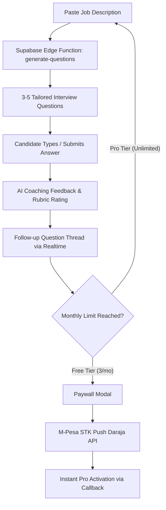

# HirePath — AI Interview Coach 💼🚀

[](https://vuejs.org/)
[](https://ionicframework.com/)
[](https://capacitorjs.com/)
[](https://supabase.com/)
[](https://developer.safaricom.co.ke/)
[](https://www.typescriptlang.org/)

**HirePath** is an AI-powered interview preparation platform engineered for job seekers in Kenya and emerging tech markets. Candidates paste any job description to instantly receive role-specific interview questions, practice their answers, and receive real-time AI coaching critiques, scoring rubrics, and follow-up prompts. Pro access is unlocked seamlessly via one-tap **Safaricom M-Pesa** STK Push payments.

---

## 📱 Interactive Mobile App Preview

You can test and explore the complete application flow inside an interactive mobile simulator **before cloning or installing the codebase**:

👉 **[Open Interactive Mobile Preview](https://brianodero.github.io/HirePath/preview.html)** — runs live in your browser, nothing to download.

> **How to open:**
> Simply double-click [`preview.html`](preview.html) in your file manager or open it in any web browser (`google-chrome preview.html` or `firefox preview.html`).
> 
> * **Interactive features in the preview:**
>   * **Auth Flow:** Hero 96×96px brand logo, vertically centered card cluster, Sign In / Sign Up toggle, Google Sign-in simulation, and Password Recovery.
>   * **Practice Hub:** Dynamic time-of-day greeting, monthly usage tracker, and live AI question generation simulation from raw job descriptions.
>   * **AI Coaching Thread:** Expandable accordion interview questions, score breakdowns, AI critique bubbles, and follow-up conversation.
>   * **M-Pesa STK Push Simulation:** Realistic Safaricom SIM Toolkit push overlay (`KES 1.00`), instant PIN simulation, and immediate Pro tier entitlement activation.
>   * **Theme Switcher:** Live toggle between Light and Dark mode with brand-accurate CSS color palettes.
>   * **Screen Toolbar:** Instant jump buttons to test any screen or modal state on demand.

---

## 💡 How the App Works



### 1. Authentication & Onboarding
* **Dual Auth Options:** Email/password credentials (with email verification and password reset flows) alongside Google Sign-In (native Capacitor Google Auth on Android, OAuth redirect on web).
* **Balanced UI Layout:** Centered visual hierarchy with balanced vertical and horizontal proportions across all screen sizes.

### 2. Tailored Question Generation
* Paste any raw job description (up to 6,000 characters).
* The backend Supabase Edge Function (`generate-questions`) parses key competencies, seniority level, and technical stack to construct 3–5 challenging interview questions with sample high-scoring answers.

### 3. AI Coaching Feedback Loop
* Candidates submit their answers per question.
* The `submit-feedback` Edge Function evaluates answers against an evaluation rubric:
  * **Score:** 1–10 rating based on clarity, structure (STAR method), and technical depth.
  * **Critique:** Constructive feedback detailing what was strong and what was missed.
  * **Follow-up Question:** An adaptive follow-up question to test real-world trade-offs.
* Changes sync to the UI via **Supabase Realtime**.

### 4. Freemium & M-Pesa Daraja Payments
* **Freemium Allowance:** 3 free practice sessions each calendar month (resets on the 1st).
* **Pro Tier:** Unlimited practice sessions and AI coaching feedback threads.
* **Instant Safaricom STK Push:** Users enter their Kenyan phone number (`+254 7XX...`). Daraja API triggers a prompt directly on the user's phone.
* **Automated Entitlements:** Supabase database webhooks process the Daraja callback, verify payment status, update the user profile to Pro, and generate a downloadable PDF statement.

---

## 📚 Documentation Index

All technical guides, architectural blueprints, and setup runbooks are located in [`docs/`](docs/):

| Documentation File | Description & Scope |
|---|---|
| 📘 [`docs/TECHNICAL_README.md`](docs/TECHNICAL_README.md) | **Core Architecture Guide:** Database schema, RLS policies, Edge Function APIs, Realtime listeners, and comprehensive tech stack specifications. |
| ⚡ [`docs/backend-setup.md`](docs/backend-setup.md) | **Supabase Setup Runbook:** Step-by-step instructions for deploying database migrations, secrets, Edge Functions, storage buckets, and cron jobs. |
| 📋 [`docs/ai-interview-coach-ionic.md`](docs/ai-interview-coach-ionic.md) | **Product Requirements Document (PRD):** Functional and non-functional requirements, user personas, UX flows, and product roadmap. |
| 💳 [`docs/daraja-api-stk-push-documentation.md`](docs/daraja-api-stk-push-documentation.md) | **M-Pesa Integration:** Safaricom Daraja STK Push workflow, callback processing, passkey generation, and query fallbacks. |
| 🌐 [`docs/DARAJA_SETUP_LOCATION.md`](docs/DARAJA_SETUP_LOCATION.md) | **Daraja Portal Configuration:** Safaricom developer portal credential management, IP whitelisting, and callback URL setups. |
| 🔥 [`docs/FIREBASE_SETUP.md`](docs/FIREBASE_SETUP.md) | **Android & Firebase Setup:** Capacitor Android platform setup, keystore signing, and Firebase App Distribution for internal testing. |
| 🔑 [`docs/google-signin-setup.md`](docs/google-signin-setup.md) | **Google Auth Setup:** Google Cloud OAuth 2.0 Client IDs, SHA-1 fingerprint registration, and Capacitor Google Sign-In plugin configs. |
| 🔒 [`docs/GITHUB_SECRETS_SETUP.md`](docs/GITHUB_SECRETS_SETUP.md) | **Secrets Reference:** Guide on required GitHub repository secrets for automated CI/CD builds. |
| 🚀 [`docs/README_CICD.md`](docs/README_CICD.md) | **CI/CD Pipeline:** Automated GitHub Actions workflows and Fastlane pipelines for building Android APKs/AABs. |
| 🛠️ [`docs/TROUBLESHOOTING.md`](docs/TROUBLESHOOTING.md) | **Troubleshooting Runbook:** Resolutions for common build, Capacitor plugin, auth redirect, and Daraja callback errors. |

---

## 🗂️ Codebase Architecture

```
HirePath/
├── docs/                             # Full technical, payment & CI/CD documentation
├── preview.html                      # Standalone interactive mobile app simulator
├── public/                           # Static assets, logos & favicon
├── src/
│   ├── App.vue                       # Root application shell (IonApp + IonRouterOutlet)
│   ├── main.ts                       # App bootstrapper (Pinia, VueQuery, IonicVue, Theme)
│   ├── core/
│   │   ├── services/                 # Supabase client, Realtime, & Edge Function APIs
│   │   ├── stores/                   # Global theme store (Light / Dark / System)
│   │   └── types/                    # Core TypeScript domain models & interfaces
│   ├── features/
│   │   ├── authentication/           # LoginView, ForgotPasswordView, ResetPasswordView, GoogleAuth
│   │   ├── interview/                # PracticeView, HistoryView, SessionDetailView, FeedbackChat
│   │   ├── payments/                 # PaymentsView, MpesaModal, Daraja polling composables
│   │   ├── settings/                 # ProfileView, Account management, Theme switcher
│   │   └── subscription/             # PaywallView, Pro entitlement guards, usePaywall
│   ├── theme/
│   │   └── variables.css             # Ionic palette, brand variables & dark mode definitions
│   └── views/
│       └── TabsPage.vue              # Main bottom tab bar navigation (Practice, History, Profile)
├── supabase/
│   ├── functions/                    # Deno Edge Functions (generate-questions, daraja-stk, etc.)
│   └── migrations/                   # Postgres DDL migrations, RLS policies, & indexes
├── capacitor.config.ts               # Capacitor hybrid mobile configuration
├── vite.config.ts                    # Vite build & bundler configuration
└── package.json                      # NPM dependencies & build scripts
```

---

## 🛠️ Quick Start & Local Setup

### Prerequisites
* **Node.js**: v18.0.0 or higher
* **npm**: v9.0.0 or higher
* **Supabase CLI** (optional, for local Edge Function development)

### 1. Clone & Install Dependencies
```bash
git clone https://github.com/codinghashira/HirePath.git
cd HirePath
npm install
```

### 2. Configure Environment Variables
Copy `.env.example` to `.env` and fill in your Supabase project credentials:
```bash
cp .env.example .env
```

Key environment keys in `.env`:
```ini
VITE_SUPABASE_URL=https://your-project.supabase.co
VITE_SUPABASE_ANON_KEY=your-anon-key
VITE_GOOGLE_WEB_CLIENT_ID=your-google-client-id.apps.googleusercontent.com
```

### 3. Launch Development Server
```bash
npm run dev
```
Navigate to `http://localhost:5173` in your browser.

---

## 🧪 Available Scripts

| Command | Description |
|---|---|
| `npm run dev` | Starts the local Vite development server with hot-reload. |
| `npm run build` | Runs TypeScript typecheck (`vue-tsc`) followed by production Vite bundling. |
| `npm run preview` | Locally serves the compiled production build from `dist/`. |
| `npm run lint` | Runs ESLint to check for code style and syntax consistency. |
| `npm run test:unit` | Executes unit tests with Vitest. |
| `npm run test:e2e` | Runs end-to-end user journey tests with Cypress. |

---

## 📱 Mobile Platform Builds (Android)

HirePath uses **Capacitor 8** to build native Android packages:

```bash
# 1. Build web assets
npm run build

# 2. Sync web assets into Android project
npx cap sync android

# 3. Open in Android Studio
npx cap open android
```

To configure automated cloud builds and release tracks, refer to [`docs/FIREBASE_SETUP.md`](docs/FIREBASE_SETUP.md) and [`docs/README_CICD.md`](docs/README_CICD.md).

---

## 📄 License & Terms

Licensed under the MIT License. See [LICENSE](LICENSE) for details. By using HirePath, you agree to the Terms of Service and Privacy Policy outlined within the application.
